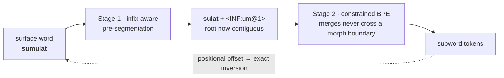

<div align="center">

# 🌏 MorphAustro-Tok

### Does morphological *correctness* matter for tokenization?<br/>A scrambled-control study in Tagalog

<p>
  <a href="paper/morphological-correctness-tokenization-tagalog.pdf"></a>
  
  
  
  
  
</p>

**[Abdul Rehman Antall](mailto:l230605@lhr.nu.edu.pk)** (FAST-NUCES, Lahore) · **[Baidya Nath Saha](mailto:baidya.saha@concordia.ab.ca)** (Concordia University of Edmonton)

</div>

---

> **TL;DR.** We built a tokenizer that recovers Tagalog roots that BPE cannot represent. It improves machine translation by up to **+3.4 chrF++**. We then replaced the linguistic analysis with a deliberately **wrong** one that keeps the same structure, and **the gain stayed.** At this scale, the benefit comes from *how consistently* words are cut. Whether the cuts are linguistically correct made no detectable difference.

---

## 🧩 The puzzle

Tagalog marks voice with **infixes**, which are morphemes inserted *inside* the root:

```
sulat   "write"
s-um-ulat   "wrote"          (actor voice,   -um-)
s-in-ulat   "was written"    (patient voice, -in-)
```

The root `sulat` is **no longer a contiguous substring** of the word. BPE builds tokens by merging *adjacent* symbols, so no sequence of merges can ever recover `sulat` from `sumulat`. Each inflected form ends up as an unrelated whole-word type.

The usual reasoning in the typology-aware tokenization literature goes:

> *Respect the morpheme boundaries → preserve information → better models.*

That reasoning mixes two properties of a tokenizer:

1. **Where** the cuts fall, which is a question of *linguistic correctness*.
2. **How consistently** a given word type is cut, which is a question of *structure and granularity*.

Most studies change both at once and credit any gain to (1). **This project separates them.**

---

## 🔬 The experiment: three tokenizers, one variable

| Arm | What it does to `sumulat` | Linguistically correct? | Consistent & invertible? |
|---|---|:---:|:---:|
| **`BPE`** — corpus-matched baseline | frequency-driven merges, root fragmented | ✗ | ✓ |
| **`MORPHAUSTRO`** — ours | `["sulat", "<INF:um@1>"]` | ✓ | ✓ |
| **`SCRAMBLED`** — the control | e.g. `["suulat", "<INF:m@2>"]` | ✗ (*deliberately*) | ✓ |

**MorphAustro-Tok** is a two-stage tokenizer:



The **scrambled-morpheme control** is the core of the design. It fires on *exactly* the same word types as the real analyzer and keeps the same morph count, invertibility, and per-type consistency. The difference is that it cuts out a pseudo-infix at an `(offset, length)` that is **guaranteed to differ** from the true analysis. Paradigm members stop collapsing onto a shared root. If the gain survives the scramble, linguistic correctness was not what produced it.

All three arms are compared at **three fertility levels** (`F0` fine → `F2` coarse, matched tokens/char), with **3 seeds** each, on:

- 🔤 **Machine translation** Tagalog→English (FLORES+ and in-domain ParaCrawl), scored with chrF++
- 🏷️ **Named-entity recognition** (WikiANN `tl`), scored with F1
- 🧪 **Mechanism probes**: Tagalog voice and Indonesian numeral-classifier agreement (*exploratory*)

---

## 📊 Headline results

### 1. MorphAustro-Tok beats matched BPE on MT, and the gap *grows* as segmentation coarsens

| Fertility | Δ chrF++ (FLORES+) | Δ chrF++ (in-domain) |
|:---:|:---:|:---:|
| F0 (fine) | **+0.84** | **+1.17** |
| F1 | **+1.49** | **+1.63** |
| F2 (coarse) | **+3.40** | **+3.93** |

<sub>MORPHAUSTRO − BPE, paired bootstrap, all Holm-corrected p < 0.001.</sub>

Token count doesn't explain this, because the gain grows as sequences get *shorter*. Capacity doesn't explain it either: at F2 the scrambled arm has **more** parameters and still scores **lower**.

### 2. …but scrambling the analysis barely matters

| Fertility | MORPHAUSTRO − BPE | SCRAMBLED − BPE | Real vs. scrambled |
|:---:|:---:|:---:|:---:|
| F1 | +1.49 | +1.54 | **−0.055** |
| F2 | +3.40 | +2.74 | **+0.661** |

<sub>FLORES+ chrF++. The two differences have opposite signs, and both are far below between-seed dispersion.</sub>

**We detect no contribution from morphological correctness at this scale.** A tokenizer that gives Tagalog roots a *consistent* contiguous unit gets the gain, whether or not that unit is the real root.

### 3. One asymmetric signal: NER

On named-entity recognition, scrambling costs **0.023 F1** relative to the real analysis, a result that survives both uncertainty floors. The real analysis, however, does **not** beat BPE on this task. This is the one place where correctness may carry weight, and it needs follow-up at larger scale.

> 📁 Full per-cell numbers: [`results/tables/results.md`](results/tables/results.md) (also as [LaTeX](results/tables/results.tex) and [CSV](results/tables/)).

---

## 🛡️ Built to be hard to fool

This project tries to avoid fooling itself. The pipeline includes:

- **16+ validation gates (G1–G16)** written as code that **halts on failure**. They caught **nine real defects** before any result was reported, including an NFC offset bug that was silently corrupting decoded MT output.
- **SHA-256 provenance** for every corpus, with pinned OPUS URLs. A failed fetch raises an error and never falls back to a substitute.
- **An enforced compute budget.** A `Budget` object refuses to start any run it projects can't finish inside the 10 T4-hour cap.
- **Dispersion and significance reported separately.** Seed-level 95% CIs *and* paired bootstrap, with Holm correction, all computed in code.
- **Probes checked for circularity.** The Tagalog voice probe turned out to be solvable from the `<INF:…>` token alone (trivial-baseline accuracy 1.000). It is **flagged as diagnostic and carries no evidential weight.**
- **Design revisions based on measurement and logged.** Indonesian MT/NER arms were cut once the gates showed only 0.18% fertility separation (vs. 7.00% for Tagalog). Malay/Indonesian pooling was refused on measured FLORES+ divergence.
- **Void runs kept in the record.** Runs before a throughput rescale are excluded from analysis, but their outputs are archived and their compute remains in the ledger.

All limitations are documented in [`results/logs/limitations.json`](results/logs/limitations.json) and [`results/logs/reproducibility_checklist.json`](results/logs/reproducibility_checklist.json).

---

## 🗂️ Repository layout

```
morphaustro-tok/
├── paper/
│   └── morphological-correctness-tokenization-tagalog.pdf   ← the paper
├── notebooks/                       ← cumulative: each part contains the previous ones
│   ├── 01_foundations_tokenizer_and_gates.ipynb             §1–§9  env, budget, corpora, MorphAustro-Tok, gates, models
│   ├── 01b_foundations_with_data_access_probes.ipynb        Part 1 + HF/FLORES+/OPUS access checks
│   ├── 02_data_ingestion_and_live_gates.ipynb               + bitext filtering, pooling gate, contamination (G9), live gates
│   └── 03_training_evaluation_and_statistics.ipynb          + MT/NER/probes, run matrix, executor, statistics, tables
├── results/
│   ├── tables/        results.md · results.tex · dispersion / comparisons / control_contrasts CSVs
│   ├── logs/          per-run results, gate log, budget ledger, analysis, limitations, repro checklist
│   ├── manifests/     environment + config manifest for every session (versions, flags, hashes)
│   └── predictions/   per-run model outputs (JSON); _void_archive/ holds excluded pre-rescale runs
├── checkpoints/       model weights (~1 GB, git-ignored, not in the repo)
├── CITATION.cff
└── README.md
```

Run IDs follow `{lang}_{ARM}_{fertility}_s{seed}__{config_hash}`, e.g. `tgl_MORPHAUSTRO_F2_s17__101ff8780f029045`. The same `config_hash` links a run's checkpoint, predictions, and manifest.

---

## 🚀 Reproducing

The experiment is designed for **Google Colab on a single T4 GPU**.

1. Open [`notebooks/03_training_evaluation_and_statistics.ipynb`](notebooks/03_training_evaluation_and_statistics.ipynb) in Colab. It is the complete, cumulative notebook. Parts 1–2 are earlier checkpoints of the same file.
2. Add a Colab secret named **`HF_TOKEN`** (🔑 icon in the sidebar). You need it for gated FLORES+ access. **Never print it in a cell.**
3. Mount Google Drive. Artefacts are written to `/content/drive/MyDrive/Austronesian Research/`.
4. Run top to bottom. Gates halt on failure, the budget refuses runs that can't finish, and stale checkpoints are refused instead of resumed.

> ⚠️ **Reproducibility scope.** Seeds, configs, and protocol are fully controlled. Bitwise determinism is **not** guaranteed, because T4 fp16 reductions under AMP have no deterministic kernels. Each manifest records which determinism flags were achievable.

**Data sources:** [FLORES+](https://huggingface.co/datasets/openlanguagedata/flores_plus) (eval) · [ParaCrawl v9 via OPUS](https://opus.nlpl.eu/) (MT training) · [WikiANN](https://huggingface.co/datasets/unimelb-nlp/wikiann) (NER)

---

## ⚖️ Scope and honest caveats

- Models are **small and under-trained** (~1.6 epochs, greedy decoding), so absolute chrF is floor-level (6–11). Only **within-language, controlled contrasts** are interpretable.
- At **F0** there is **no scrambled control**, so effects at that level are uncontrolled.
- There is a train/test register gap: ParaCrawl *Tagalog* vs. FLORES+ *Filipino* (60.9% of test types are unseen in training).
- The study was not preregistered. Hypotheses and the decisive criterion were fixed *before the runs were executed*.

We do **not** claim morphological correctness is inert. Our claim is narrower: at this scale, on these tasks, we could not detect a contribution from it.

---

## 📚 Citation

```bibtex
@article{antall2026morphaustrotok,
  title   = {Does Morphological Correctness Matter for Tokenization?
             A Scrambled Control Study in Tagalog},
  author  = {Antall, Abdul Rehman and Saha, Baidya Nath},
  year    = {2026},
  url     = {https://github.com/AbdulRehmanAntall/morphaustro-tok}
}
```

<div align="center">

**If this work changed how you think about tokenizers, consider giving the repo a ⭐**

*Kumain ka na ba?* 🍚

</div>
